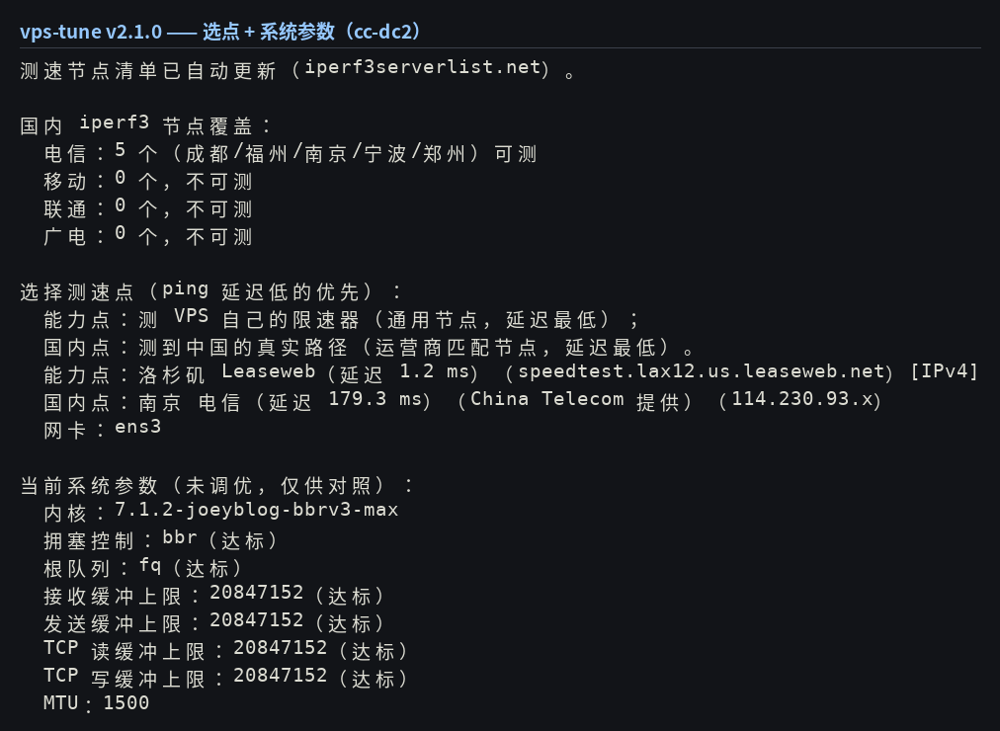
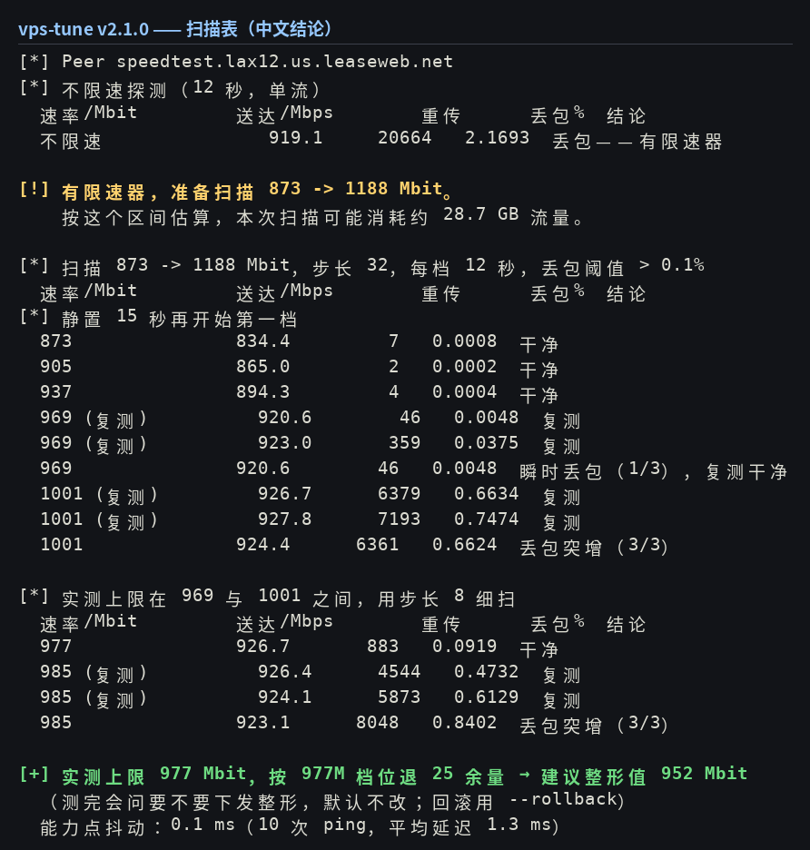
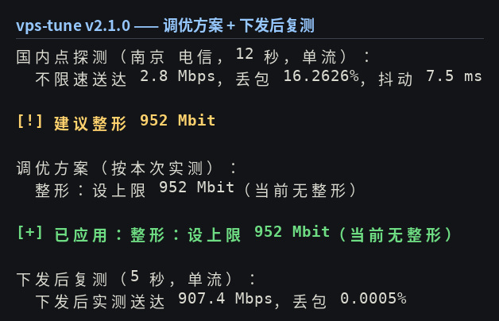
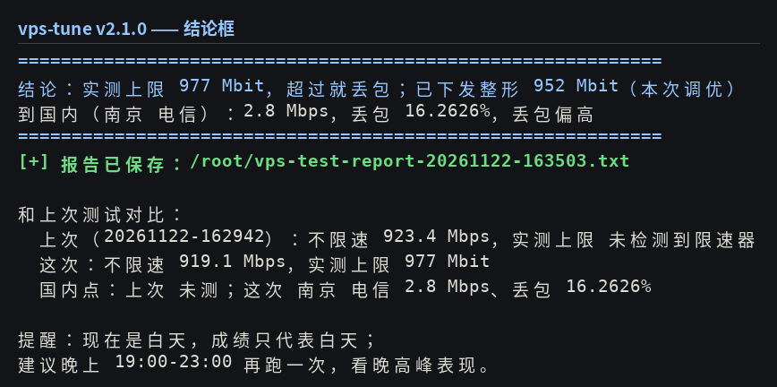
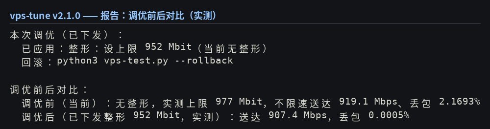

# vps-tune

VPS 验货工具：测真实带宽、找限速器、给人话结论。给国内买 VPS 的人用。

一键测出这台 VPS 的真实带宽、有没有限速器、限速器在哪、链路干不干净、抖动大不大，最后给一句人话结论，帮你验货、避坑。

## v2.1.2：完整 IP + 全达标收尾行

- **终端和报告都显示完整 IP**：不再脱敏。用户 2026-11-22 决定：跑工具的是自己的机器、看输出的是自己，IP 打码没意义——SSH 源 IP、测速点 IP、报告里的 IP 全都完整显示。`mask_ip()` 已整个删除（v1.0.4 加的脱敏功能就此废止）。
- **全达标时绿色收尾行**：plan 为空（没东西可调）且正常完成时，结论框后面印一行绿色的“[+] 各项参数全部达标，无需调优。”。之前全达标时跑完只剩“报告已保存”和“已自动清除”，没一句明确说“都挺好、不用动”。有东西要调、取消或失败时不印；报告文件里结论区也带这句。

## v2.1.1：容差 + 快照不覆盖

- **达标容差 5 Mbit**：建议值与当前整形相差 5 Mbit 以内算已达标，不重下整形。实测上限本身有 ±2–5 Mbit 的测量噪声（cc-dc2 上建议值 952→954 抖了 2 Mbit，第二跑就把整形重下了一遍），追这点差别没意义，反而每次重下都要拆建 qdisc。超过 5 Mbit 才动（偏低放宽、偏高收紧）。
- **快照不覆盖**：已有能用的快照时，下发不再重写快照。快照是“调优前最初的状态”，连续两次下发若覆盖快照，回滚只能回到上一次下发前的状态，回不到最初状态（v2.1.0 真机验证发现）。快照损坏或不存在时重新存一份。回滚后快照照常删除，下次下发重新存。

## v2.1.0：简化

- **输出更干净**：选测速点时不再逐行印 17 行 ping 列表（只显示选中的能力点和国内点）；结论框印完后，整份报告不再往终端重印一遍（只存文件，终端提示路径）；TCP 读/写缓冲只显上限（不印 `4096 1048576 20847152` 三元组）；提供方只在选点行、报告、历史记录里出现，覆盖行不再重复。
- **人话**：扫描表里的英文结论全翻成中文（复测、丢包突增、瞬时丢包、再往上没收益、丢包——有限速器、干净）；“拐点”统一改成“实测上限”；整形文案说“设上限”不说“下发 htb”；BBR 加半句解释（换成更快的 BBR 算法）；吓人的恢复警告改温和（说明不影响上网）。
- **调优后复测**：下发整形后实测一次（5 秒），“调优后”显示实测送达和丢包，不再是预期值；复测失败时仍按预期显示（不假装实测）。
- **缓冲按内存自适应**：缓冲上限目标不再是所有机器一刀切 16MB——≥4GB 给 16MB，1–4GB 给 8MB，<1GB 给 4MB。小内存机器不再被抬到 16MB。
- **保留**：pfifo_fast/noqueue 换 fq 保留（平时不触发，碰上了是兜底）；测速、确认、回滚、报告、历史对比都不动。
- **实测截图**（cc-dc2，2026-11-22，实测上限 977 Mbit、建议整形 952 Mbit、复测送达 907.4 Mbps 丢包 0.0005%）：

  选点 + 系统参数（无 ping 列表、覆盖行无提供方、缓冲只显上限）：
  

  扫描表（中文结论）：
  

  调优方案 + 下发后复测：
  

  结论框（报告已保存，不重印）：
  

  报告调优前后对比（调优后是实测值）：
  

  （以上截图为 v2.1.0 实测，IP 显示为旧的打码样式；v2.1.2 起终端和报告都显示完整 IP。）

## v2.0.2：测 + 调

- **下发整形**：测完给出建议值后，问一声“是否应用以上调优？”，默认不下发（回车就是不调）。选了是才挂 htb 整形，下发完校验一次（根是 htb 且 class 1:10 的 rate 就是下发的值）。
- **基础调优**：一起下发的基础参数——拥塞控制改 BBR（已是 BBR 的不动）、接收/发送缓冲上限提到 16MB（已达标的不动）、TCP 读/写缓冲只改 max 到 16MB（保留 min/default）。根 qdisc 是 pfifo_fast/noqueue 且不下发整形时换成 fq；下发整形时根会变成 htb（叶子就是 fq），不用再单独换。
- **回滚**：下发前先把原始状态（根 qdisc + 要改的 sysctl 原始值）存到 `~/.vps-test/tune-snapshot.json`，快照存不上就停手不下发（回滚不了就不调）。`python3 vps-test.py --rollback` 把下发的调优全部恢复（qdisc 按快照原样重建，sysctl 写回原始值并删持久化文件，最后删快照）。sysctl 持久化写进 `/etc/sysctl.d/99-vps-tune.conf`，重启后仍生效；回滚时删除。
- **报告**：下发后报告里多一段“本次调优（v2.0 已下发）”，列出已应用和未生效的项，并给回滚命令；整形行不再带“未下发”后缀，结论框和调优前后对比里的“调优后”也改成“已下发整形 X Mbit”。
- **只做“测”的时代结束**：v1.0.x 的“只做测试，不改任何系统配置”已作废。v2.0 默认仍不改（要问一声），但可以下发调优。
- **v2.0.1 / v2.0.2 修的 bug**：v2.0.0 真机实测发现快照认不出自己下的整形（第二跑重下整形并报警告）——v2.0.1 修了 class 行正则（同时认 `parent 1:` 和 `root`）、快照读当场 live 的 qdisc、回滚不再劝重下；v2.0.2 又修了快照 qdisc 解析（`tc qdisc show dev` 输出里没有 `dev`，旧过滤把两行全跳过）。两版都在 cc-dc2 真机验证通过。

## v1.0.10：只做“测”，不做“调”

- **报告国内标题去嵌套括号**：报告里的国内路径标题从“到国内路径（宁波 电信（122.228.230.x）（China Telecom 提供））”改成“到国内路径：宁波 电信（122.228.230.x，China Telecom 提供）”，IP 和提供方放进同一组括号里、用逗号隔开，不再嵌套。结论框本来就是干净的，不动。
- **移除跑完的保留/删除询问**：v1.0.8 加的“是否保留本次报告和历史记录？”问答不要了，恢复默认保留——报告和历史记录跑完都留着，不再问。
- **测速点标签修干净**：选点返回的标签不再带延迟（以前是“宁波 电信（延迟 146.9 ms）”），延迟单独返回、只在选点行显示。修掉两个毛病：结论框和报告标题不再出现嵌套括号；历史对比按标签认测速点时，同一台服务器两次延迟不同也不会误判为“测速点不同”。老历史记录（标签带延迟）比对时自动去掉延迟后缀，兼容。
- **结论框加国内路径**：结论框里除了拐点和整形建议，再加一句到国内的路况（测速点、速度、丢包、链路干净与否），一眼看全；没测时写明原因。
- **历史对比加国内路径**：和上次测试对比时，除了能力点（不限速、拐点），也比国内点（测速点、速度、丢包）；两次选的国内服务器不一样时注明“测速点不同”，避免误以为是同一条路变快/变慢。
- **城市名统一中文**：API 返回的英文城市名（Chengdu/Fuzhou/Nanjing/Ningbo/Zhengzhou）统一转成中文显示，覆盖行、选点、报告全是中文；将来清单里出现新城市时，不在映射表里的原样保留。
- **运营商识别**：自动从 SSH 连接取你的源 IP，查运营商后自动选择；检测到梯子（数据中心 IP）会红字警告并让你手动选。手动菜单：1 电信 / 2 移动 / 3 联通 / 4 广电 / 0 退出。
- **本机 IP 栈**：识别双栈、仅 IPv4、仅 IPv6，测速按本机有的版本走（ping 用 `ping -4`/`-6`，iperf3 传 `-4`/`-6`）。双栈机器默认按延迟自动选（一般是 IPv4 更快）；想手动指定用 `--ip 4` 或 `--ip 6`，报告里会标注“手动指定”。注意：国内节点目前只有 IPv4，强制 IPv6 时国内路径跳过。
- **IP 脱敏**（v1.0.4 加，v2.1.2 已移除）：报告和终端展示里，主机名原样显示，IP 只显示前 3 段（IPv4 如 `122.228.230.x`，IPv6 只留前 4 组），不存完整 IP。2026-11-22 用户决定终端和报告都显示完整 IP，脱敏废止、`mask_ip()` 已删。
- **未调优参数**：扫描前显示本机当前参数（只读，供对照）：内核、拥塞控制、根 qdisc、接收/发送缓冲上限、TCP 读/写缓冲、MTU。达标的标“达标”，待优化的标“待优化”。
- **带宽与限速器**：不限速探测 + 多速率点拐点扫描（粗扫 + 细扫），找出真实上限和限速器位置。达标就不用调：当前整形落在 [建议值, 实测上限] 安全带内就报“已达标，无需调整”。
- **抖动测量**：能力点和国内点各 ping 10 次算 RTT 标准差，报告里直接给抖动数值（<5 ms 稳定，5–20 ms 一般，>20 ms 偏高）。
- **双点测**：能力点（洛杉矶/香港/新加坡/悉尼/东京，延迟最低）做完整拐点扫描，测 VPS 自己的限速器；国内点（运营商匹配节点，延迟最低）只做不限速探测，测到中国的真实路径。
- **国内节点覆盖**：一键命令后自动从 iperf3serverlist.net 拉最新国内节点（只留中国内地、在线率 ≥95%、状态绿、端口含 5201），拉不到用本地缓存（7 天内有效），再没有用硬编码清单；并列出四家运营商各有几个内地节点、能不能测（目前只有电信有 5 个：成都/福州/南京/宁波/郑州）。移动/联通/广电没有内地节点时，终端红字明确提示原因，报告里也写明。
- **提供方署名**：免费公共 iperf3 节点的提供方（商家/组织/志愿者）原样注明，数据来自节点清单的公开信息；志愿者架的节点按 IP 的 ASN 归运营商，不会漏掉。
- **快速模式**：`--quick` 每档 5 秒、只粗扫不细扫，流量省约 2/3 以上，拐点精度较粗。
- **人话报告**：结论（含国内路径）+ 调优前后对比 + 流量消耗 + 用时，保存为文本报告，并与上次测试对比（能力点和国内点都比）。调优前后对比里“调优后”是按建议值整形后的预期（v1.0.3 只测不调）。调优前红色、调优后绿色，存文件时去掉颜色码；不支持颜色的终端自动降级纯文本。
- **晚高峰提醒**：白天跑的只代表白天，建议晚上 19:00–23:00 再跑一次。

## 用法

支持 Debian / Ubuntu（已在 Debian 13、Ubuntu 24.04 上验证）。

在 VPS 上以 root 身份运行：

```bash
curl -fsSL https://raw.githubusercontent.com/4258806/vps-tune/main/vps-test.py -o vps-test.py && python3 vps-test.py
```

常用选项：

```bash
python3 vps-test.py --isp 1         # 跳过识别，直接指定运营商（1 电信 / 2 移动 / 3 联通 / 4 广电）
python3 vps-test.py --ip 6          # 手动指定 IP 版本（只测 IPv6；默认按延迟自动选）
python3 vps-test.py --peer <地址>   # 手动指定 iperf3 测速点
python3 vps-test.py --quick         # 快速模式：每档 5 秒、只粗扫不细扫
python3 vps-test.py --dur 5         # 每个速率点测试时长（秒，默认 12，范围 5-60）
python3 vps-test.py --yes           # 跳过流量确认和调优确认（无人值守用）
python3 vps-test.py --keep          # 跑完不删除脚本（默认只删脚本，报告和历史记录保留）
python3 vps-test.py --rollback      # 回滚已下发的调优（恢复下发前状态）
```

依赖：Python 3.7+ 标准库、iperf3（只当客户端）、tc（iproute2）。

```bash
apt install -y iperf3   # Debian/Ubuntu
yum install -y iperf3   # RHEL/CentOS
```

## 注意

- **流量**：拐点扫描会消耗流量，大带宽机器一次可能扫掉几十 GB。扫之前会先报预计流量，确认了再扫；无终端时默认取消。低带宽机器（比如 50M）完整扫一次不到 1GB，不用纠结。
- **自动清除**：跑完默认自动删除脚本自身，报告和历史记录保留（报告是凭证，历史供下次对比）。想留着脚本请加 `--keep`。
- **调优改系统配置**：v2.0 测完会问一声才下发调优（默认不改）；选了是才会改整形和 sysctl，下发前先存快照，随时能用 `--rollback` 恢复。只测不调时，扫描期间临时挂的测试整形器跑完立即恢复原状（已有 htb 整形会原样恢复）。
- **测速点（双点测）**：能力点（洛杉矶/香港/新加坡/悉尼/东京，延迟最低）做完整拐点扫描，测 VPS 自己的限速器；国内点（电信 5 个：成都/福州/南京/宁波/郑州，延迟最低）只做不限速探测，测到中国的真实路径。电信用户两个点都测，其他运营商只测能力点（终端会红字提示原因）。**节点清单自动更新**：一键命令后自动从 iperf3serverlist.net 拉最新国内节点，拉不到就用本地缓存或硬编码清单；提供方（商家/组织/志愿者）原样注明。
- **拐点会波动**：同一台机器不同时间测，拐点可能差几十 M（网络忙闲不同）。建议整形取多次测量里最保守的那个。

## 许可

MIT License。
